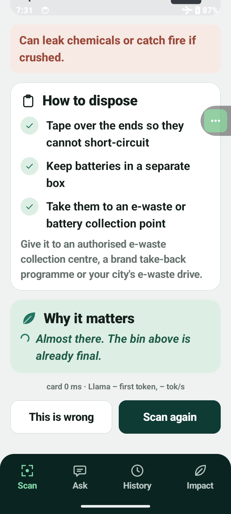
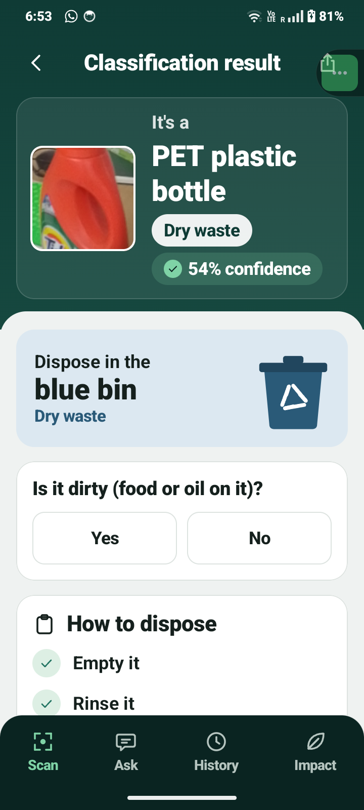
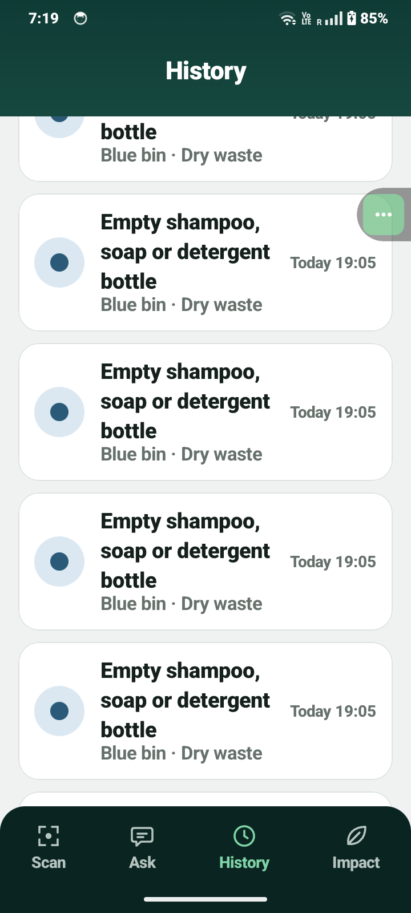

# SwachhSathi: on-device waste segregation assistant

Point a phone at a piece of waste and SwachhSathi tells you which of India's four SWM Rules 2026
bins it goes in (green wet, blue dry, red sanitary, black special care), how to prepare it, and
why, in English or Hindi, by camera, photo or voice. Everything runs offline on the phone's Arm
CPU through **ExecuTorch**: a YOLO26n detector, a SigLIP 2 image encoder, Llama 3.2 1B and an
offline speech model. The app has no internet permission at all.

<p>



</p>

**Results** (details in the [technical report](docs/TECHNICAL_REPORT.md), every number in
[eval/REPORT.md](eval/REPORT.md)):

- **Right bin on 2,371 South Asian photos** (BDWaste, wet, dry and special care): **91.9%**, because
  a detector verdict needs a second model (SigLIP 2) to agree; the detector alone gets 75.2%
  (wet waste 55.3% → 97.5%) ([§5.3](docs/TECHNICAL_REPORT.md#53-four-bin-test-on-south-asian-photos-bdwaste-and-the-agreement-rule)).
- **Llama explanations**: 98.1% useful on 416 held-out questions (96.6% on the 88 the prompt was
  chosen on; 69.3% before), every answer checked against the knowledge base, off-topic questions
  declined ([§5.2](docs/TECHNICAL_REPORT.md#52-llama-answer-quality-laptop-same-pte-as-the-phone)).
- **Detector**: YOLO26n on TACO, 9.8 MB, 0.305 mAP50 on held-out images, in the same range as much
  larger published TACO systems ([§5.1](docs/TECHNICAL_REPORT.md#51-sorting-accuracy)).
- **On an entry-level phone** (realme C61, Unisoc T612, 4 GB): detector 0.23–0.42 s per frame,
  Llama 4.4 tokens/s; the bin card never waits for Llama, and explanations are kept on the phone
  so repeat scans are instant. Real items scanned by hand: right bin for all but one (a computer
  mouse); airplane mode on throughout ([§5.6](docs/TECHNICAL_REPORT.md#56-on-a-budget-phone-speed-memory-real-items-offline)).

**Built with Llama.** Licensed under the GNU AGPL-3.0 ([LICENSE](LICENSE)); third-party licences in [THIRD_PARTY.md](THIRD_PARTY.md) and [NOTICE](NOTICE).

## Docs

- [Design](docs/DESIGN.md): problem, state of the art, architecture, tech stack
- [Hardware requirements](docs/HARDWARE_REQUIREMENTS.md): minimal, phone-first
- [Roadmap](docs/roadmap.md): phased plan from setup to submission
- [Future plan](docs/FuturePlan.md): work-package implementation guide with contracts, tests and status
- [Pipelines](docs/PIPELINES.md): the five on-device pipelines, their runtimes, models and memory policy
- [Dev setup](docs/DEV_SETUP.md): Python, Android and phone setup
- [Phone session runbook](docs/PHONE_SESSION.md): install, measure and record the demo in one ~90 minute sitting
- [Technical report](docs/TECHNICAL_REPORT.md) and [demo video script](docs/DEMO_SCRIPT.md)
- [Evaluation report](eval/REPORT.md): every measured number, regenerated from `eval/results/`

## Quick start (WSL Ubuntu)

Requires [uv](https://docs.astral.sh/uv/).

```bash
./scripts/setup_dev.sh   # installs uv if missing, syncs the env, checks tools
uv run pytest            # includes an ExecuTorch export + run smoke test
uv run ruff check .
```

Python dependencies are managed only with uv (`uv add <pkg>`, `uv run <cmd>`). `torch` and `executorch` are pinned together in `pyproject.toml`.

## How it works

1. **Scan.** Point the camera at one item, or tap the shutter to analyse a full-resolution photo, or
   pick one from the gallery. The YOLO26n detector names it and frame voting makes sure it is stable.
2. **Two models must agree.** The detector's item becomes a verdict only if SigLIP 2 also ranks it
   in its top three for the same picture; otherwise the app shows three suggestions to pick from
   instead of guessing. Items the detector never learned (peels, batteries, electronics) reach the
   user this way.
3. **The knowledge base decides the bin**, not a neural network: SWM Rules 2026 streams, bin
   colours, steps, hazards and drop-off points for 53 household items. Items whose bin depends on
   condition ask "Is it dirty?" or "Is it broken?".
4. **Llama explains.** Llama 3.2 1B writes a short "why it matters" and a tip, checked against the
   knowledge base before it is shown; anything that fails the checks falls back to the KB's own text.
   The card never waits for Llama, and every explanation it writes is kept on the phone.
5. **Ask and listen.** Type or speak a question in English or Hindi (offline speech recognition);
   off-topic questions are declined. Verdicts are read aloud. History and Impact keep a private
   record of what you sorted, with a daily fact and quiz.

Pipelines, runtimes and the memory policy: [docs/PIPELINES.md](docs/PIPELINES.md).

## Run it on a phone

From a release: install `swachhsathi.apk`, then copy the model files to the phone (steps in the
release notes). From source:

```bash
./scripts/download_models.sh llama-spinquant --accept-llama-license   # Llama 3.2 1B .pte
uv run --group finetune python models/fallback/build.py               # SigLIP 2 image encoder .pte
./models/speech/download.sh                                           # Omnilingual ASR (voice)
cd android && ./gradlew :app:assembleRelease && cd ..                 # the APK (detector + KB inside)
./scripts/install_app.sh                                              # APK + models over USB (adb)
```

On first use, open **Settings → Prepare all explanations** with the phone charging: Llama writes
every item's explanation once, on the phone, so later scans show it instantly. The full
measurement runbook is [docs/PHONE_SESSION.md](docs/PHONE_SESSION.md).

## Repository layout

| Path | Purpose | Roadmap phase |
|---|---|---|
| `docs/` | Design, pipelines, technical report, phone runbook, demo script | All |
| `kb/` | Knowledge base: disposal rules per item and city | 2 |
| `data/` | Taxonomy, dataset scripts, small fixtures | 3, 5 |
| `pipeline/` | Python reference of the app's logic (KB, prompt, verifier, voting, voice, impact) | 2+ |
| `models/` | Export and training code for Llama (+ LoRA), vision, SigLIP fallback, speech | 1, 3, 5–7 |
| `android/` | Kotlin: `core/` (tested port of `pipeline/`) and `app/` (the Android app) | 1, 4+ |
| `eval/` | Accuracy, latency and offline evaluation | 9 |
| `scripts/` | Dev setup, model download, install on the phone, phone measurements, release | 0+ |
| `tests/` | `uv run pytest` | 0+ |

Model binaries and raw datasets are not committed.
