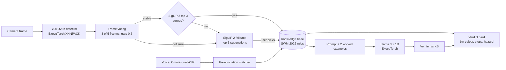

# Technical report: SwachhSathi, an on-device waste segregation assistant

Bharat AI-SoC Challenge, PS2 (Edge AI for waste classification and disposal). Every number below
comes from a result file in `eval/results/`; [eval/REPORT.md](../eval/REPORT.md) regenerates the
tables with `uv run python eval/report.py`. Phone measurements come from one session on an
entry-level phone (§5.6).

## 1. Problem and goal

India's Solid Waste Management Rules, 2026 require households to separate waste into four streams:
**wet** (green bin), **dry** (blue), **sanitary** (red) and **special care** (black). People get it
wrong most on mixed, dirty and hazardous items: a greasy pizza box, a chips packet, a broken CFL
bulb, a used diaper.

Goal: point a phone at an item and get, within a fraction of a second, the right bin, how to prepare
the item, and why — fully offline, in English and Hindi, with Llama running on the phone's Arm CPU
through ExecuTorch.

## 2. Design principle: vision perceives, the knowledge base decides, Llama explains

- **The bin never comes from a neural network's guess.** A curated knowledge base (KB: 53 items,
  condition rules for dirty and broken items, a city profile with bin colours) decides stream, bin,
  steps, hazards and drop-off points. Sources: SWM Rules 2026 and the SBM-Urban source-segregation
  guideline, E-Waste Rules, US EPA guidance for mercury items.
- **Two models must agree before the app commits to an item**: the detector's choice stands only
  if SigLIP 2 independently ranks it in its top 3; otherwise the user picks from suggestions. On
  South Asian photos this lifts the right bin from 75% to 92% (§5.3).
- **Vision only names the item** (detector, frame voting, a "not sure" state) and, for the ten items
  whose advice depends on it, asks whether the item is dirty or broken.
- **Llama 3.2 1B only explains**: a one-or-two-sentence `why` and a `tip`. A verifier checks every
  answer against the KB and drops wrong text (wrong or negated bin or stream, wrong recyclable or
  compostable claim, a KB step turned into "don't", unsafe advice such as drains or burning).
  Off-topic questions are declined before Llama runs.
- **The verdict never waits for Llama**: the card with bin colour and steps appears first, and the
  explanation streams in after it.

## 3. System

Five separate on-device pipelines, all on the Arm CPU, none using the network (the app has no
INTERNET permission). Runtimes, models and memory policy: [PIPELINES.md](PIPELINES.md).

| Stage | Model / method | Size | Runs |
|---|---|---|---|
| Detection | YOLO26n (Ultralytics) fine-tuned on TACO, exported to ExecuTorch XNNPACK; decoding + NMS in app code (the exporter drops the NMS-free head) | ~9 MB | every frame |
| Stability | Confidence gate 0.5; an item is stable after winning 3 of the last 5 frames | – | every frame |
| Agreement | A stable detector item becomes a verdict only if SigLIP 2 also ranks it in its top 3 (§5.3) | 0 MB extra | before each verdict |
| Unknown items | SigLIP 2 base image encoder, int8 `.pte`, cosine against KB item text embeddings; top 3 offered, never auto-decided | 94 MB | when not sure or not agreed |
| Dirty / broken | Same SigLIP 2 embedding vs item-specific prompts ("dirty milk pouch" vs "clean milk pouch"); in the unsure band the app asks the user | 0 MB extra | stable item with condition rules |
| Decision | KB (`kb.sqlite`) + city profile | <1 MB | every verdict |
| Explanation | Llama 3.2 1B Instruct SpinQuant INT4 `.pte` + verifier; loads on first use, answers kept on the phone | 1.1 GB | 1.5 s after the card, or instantly from the phone's cache |
| Voice | Omnilingual ASR 300M CTC int8 (sherpa-onnx) → pronunciation-key matcher; Android text-to-speech | 366 MB | push-to-talk |
| Impact | Scan log, items by stream, kg kept out of landfill (estimate), streak; education cards and quiz from KB facts | – | on demand |

**Parity by construction.** Every decision function exists in Python (the laptop reference) and in
plain Kotlin (`android/core`, used by the app). Both pass the same golden fixtures and shared case
files in CI (KB lookup, prompt text byte for byte, verifier, detector decoding, voting, fallback
ranking, dirty/broken check, voice matching, impact, latency summaries, correction log).

## 4. Data and models

- **Knowledge base**: 53 household items in 4 streams, English + Hindi text (Hindi not yet reviewed
  by a native speaker), condition rules for 10 items, one default city profile.
- **Detector data**: TACO (1,500 images). 14 of our KB items have enough TACO instances to train;
  the rest reach the user through the fallback, voice or search. TACO's image licences are mixed
  (466 ODbL, 319 "CC" without a variant, 715 with none); training used all images, the release
  documents this ([THIRD_PARTY.md](../THIRD_PARTY.md), [data/taco_licences.md](../data/taco_licences.md)).
- **Open South Asian detection data, checked and not used.** DWSD (Kolkata, CC BY 4.0, 784
  images): about half the images are rotated or tinted copies of the same scenes, so its own
  train/test split leaks (the closest test/train pairs are the same pile of litter), dense scenes
  are labelled sparsely, and several classes do not match their names (most "thermocol" regions
  are wrappers and cardboard). pLitterStreet (Sri Lanka, Thailand, Vietnam, CC BY 4.0): vehicle
  camera views where the median object covers under 0.1% of the frame, mostly labelled just
  "litter". Training on either would have taught the detector wrong or irrelevant labels; the
  India-specific test comes from real items on the phone (§5.6) and BDWaste (§5.3) instead.
- **Detector training**: YOLO26n from COCO weights, 640 px, batch 16, on the laptop CPU (up to 50
  epochs, early stop after 15 without gain: stopped at epoch 37, best at 22, about 4 hours); the
  same settings run on a GPU from `models/vision/train.ipynb`.
- **Llama**: the prebuilt `executorch-community` Llama 3.2 1B Instruct SpinQuant INT4 `.pte`. A LoRA
  fine-tune on 470 KB-written examples is fully tooled and dry-run verified but was not run (it
  needs gated weights and a GPU session); prompt design closed most of the gap instead (§5.2).

## 5. Results

### 5.1 Sorting accuracy

YOLO26n (2.4 M parameters) trained on the 1,138 TACO images that contain one of our 14 items
(train / val / test 870 / 138 / 130). Scored on the 130 held-out test images (247 objects).

**Standard box metrics** (Ultralytics val): **mAP50 0.305, mAP50-95 0.237**. Best classes: PET
bottle 0.64, aluminium can 0.57, glass bottle 0.45, carry bag 0.38 mAP50. Classes with 1–5 test
objects (broken glass, foil, used tissue, Tetra Pak) and newspaper are weak.

**The exported `.pte` matches PyTorch**: on the same input tensor, raw boxes agree within 0.011 px
and scores within 1e-5, with identical detections on 20 test images.

**What the user gets** (the `.pte` with the app's own pre- and post-processing). Per frame, the app
takes the most confident detection; below the confidence gate it says "not sure" and offers the
fallback suggestions instead of guessing. The gate was chosen on the val split: 0.5 is the lowest
gate whose verdicts reach the 92% stream target there (92.6%, verdicts on 59% of images; full sweep
in [eval/REPORT.md](../eval/REPORT.md)). On the test split at gate 0.5:

| Images with a verdict | Verdict names the right item | Verdict puts it in the right stream |
|---|---|---|
| 66.1% | 59.3% | **88.4%** (target 92%) |

Read the stream number with care: 13 of the 14 detector classes are dry waste, so on TACO a stream
error is almost always a box on the background, not a wrong bin (9 of 10 wrong-stream verdicts on
test). The meaningful test of wet / sanitary / special-care sorting is the phone session's real-item
set (§5.6), where the KB and fallback carry the 39 items the detector does not know.

**State of the art on TACO.** Results depend heavily on the class set, so these are context, not a
leaderboard. The TACO authors' Mask R-CNN (ResNet-50 FPN, 1024 px) reached 17.6–19.4 mask AP
(IoU 0.5:0.95) on a 10-class split ([Proença & Simões 2020](https://arxiv.org/abs/2003.06975)). A
2026 study on TACO's 28 supercategories reports 0.245 mAP50 for a direct YOLO26s at 768 px and 0.335
for its best two-stage hierarchical system with multi-view inference (Skinderowicz, KES 2026). Our
nano model at 640 px, trained on a laptop CPU in about four hours, reaches 0.305 mAP50 on 14 classes:
in the same range as much larger published systems, small enough (9.8 MB) to run every camera frame
on a phone. Fewer classes make our task easier, and it is not a like-for-like comparison.

### 5.2 Llama answer quality (laptop, same `.pte` as the phone)

| Setup (SpinQuant 1B, 88 held-out questions, en + hi) | Useful | Valid JSON | Tokens |
|---|---|---|---|
| Restate all 7 facts as JSON (first design) | 10% (format only) | – | – |
| `why` + `tip` only, answer start prefilled (baseline) | 69.3% | 96.6% | 76 |
| + 2 worked examples matched to the question kind | 92.0% | 100% | 61 |
| + stricter rules | 95.5% | 100% | 63 |
| + sampled retry only when the checks fail (**shipped**) | **96.6%** | 100% | 66 |

**Confirmed on 416 more questions.** The variants were chosen on the 88 validation questions, so
the shipped setup was then run once on the 416 training-split questions, which the stock SpinQuant
model has never seen: **98.1% useful** (English 98.6%, Hindi 97.6%), 99% valid JSON, 1.09 attempts
per answer, 63 tokens. The 8 failures were 4 unparseable outputs and 4 answers the verifier stopped
(two unsafe, one wrong recyclable claim, one negated step); none reach the user.

Useful = valid, passes every verifier check, has a `why` in the requested language. 18 variants
were measured (prompt wording, fact format, examples, KB-written first sentence, temperature,
retries, SpinQuant vs QLoRA): [eval/results/llm_experiments/README.md](../eval/results/llm_experiments/README.md).
A hand check of 16 random answers found them all consistent with the KB; two Hindi answers have
awkward grammar. Off-topic questions: the guard declines all of them (126/126 across validation
and training cases) and wrongly stops none of the 504 on-topic ones. Its fixed test questions are
simple ("What is the capital of France?"), so this shows the guard is not over-eager, not that it
catches every off-topic phrasing.

Whatever still fails is never shown: the card keeps the KB's own text. So the user-facing error rate
for bin and steps is zero by construction; Llama errors only cost an explanation.

### 5.3 Four-bin test on South Asian photos (BDWaste) and the agreement rule

**Data.** BDWaste (Rahman et al., Data in Brief 2024, CC BY 4.0): close-up phone photos of single
waste items taken around Dhaka. 19 of its 21 classes map to KB items: 2,371 photos across **wet**
(peels of banana, mango, potato, lemon and orange, sugarcane husk, egg shells, rice, fish waste),
**dry** (bottles, cans, chips packets, polythene, glass shards, empty blister packs, paper, coffee
cups, plastic jugs) and **special care** (wires). Masks and gloves are skipped: the KB has no item
for them yet. Many photos within a class repeat the same arrangement, so the 120–130 photos per
class are less varied than the count suggests. Script: `eval/bdwaste/evaluate.py`.

**Finding: the detector alone sends wet waste to the dry bin.** It only knows 14 dry-or-sanitary
TACO items, and it is confidently wrong on what it has not seen: orange halves, sugarcane husk and
fish waste come out as "carry bag" (105, 93 and 121 times). The SigLIP 2 suggestions, zero-shot,
name these far better.

**Fix: the agreement rule.** A detector verdict now stands only when SigLIP also ranks that item in
its top 3 for the same frame; otherwise the app shows SigLIP's three suggestions instead of a
verdict (`pipeline.fallback.confirms`, `FallbackRank.confirms`, shared fixture). Same photos, same
models, scoring the item the user would get (the verdict, or the first suggestion):

| Rule | Right bin | Wet | Dry | Special care | Right item | Right item in the 3 offered |
|---|---|---|---|---|---|---|
| Detector decides alone (before) | 75.2% | 55.3% | 93.1% | 95.0% | 49.3% | – |
| **Agreement (shipped)** | **91.9%** | **97.5%** | 85.7% | 97.5% | **70.8%** | 90.2% |

Firm verdicts drop to 13% of photos but are right on bin 95% of the time; every other photo gets
three suggestions to confirm. Dry falls a little because a user tapping the first suggestion is
counted as is; in the app they see all three. Cost: one extra SigLIP pass (about the size of the
fallback pass) before a verdict, timed as the `agreement` stage on the phone (§5.6).

**Whole photo, not the item crop.** Running the agreement check on the detector's crop (which would
let one SigLIP pass also serve the dirty/broken check) was measured on the same photos: overall
right bin 92.1% (vs 91.9%), but firm verdicts were right on bin only 90.4% of the time (vs 95.4%),
and wet waste fell to 95.9% (vs 97.5%). The whole photo stays.

**Fallback alone on TACO crops** (earlier check): 83.5% top-3 (68.4% top-1) on 133 TACO object
crops with the int8 encoder that ships, within one point of fp32, zero-shot.

### 5.4 Dirty / broken check

Zero-shot "broken" on TACO glass crops (136 broken, 110 intact): AUC 0.68. With the shipped band it
answers on its own for 16% of crops at 90% accuracy and asks the user for the rest. "Dirty" has no
labelled data yet, so the app always asks. Honest conclusion: zero-shot condition detection is weak;
asking the user is the safe default.

### 5.5 Voice (Hindi)

Omnilingual ASR + pronunciation matching, synthetic speech: 92.5% of item names and 87.5% of names
inside full sentences matched first time (97.5% in the top 3), no false confident matches. Native
speakers and real kitchens are still to be measured.

### 5.6 On a budget phone: speed, memory, real items, offline

Measured on a realme C61 (Unisoc T612: 2 × Cortex-A75 + 6 × A55, 4 GB RAM, Android 14), an
entry-level phone rather than a flagship ([DEVICE.md](DEVICE.md),
[session notes](../eval/results/phone/session_notes_2026-11-19.md)).

| Stage | Measured |
|---|---|
| Detector (YOLO26n, 640 px, XNNPACK) | 226–420 ms per frame |
| Llama 3.2 1B SpinQuant: load | ~30 s, once |
| Llama: first token / decode | 15.7 s / 4.4 tokens/s |
| App memory with Llama loaded | ~1.2–1.3 GB (RSS) of 3.7 GB |

For reference, ExecuTorch reports 50.2 tokens/s and 0.3 s to first token for the same model on a
flagship (OnePlus 12): this phone is roughly 10x slower, so the design leans on it. The bin card
never waits for Llama; Llama loads on the first explanation, not at start; and every explanation
Llama writes is kept on the phone, so the next scan of the same item and condition shows it at
once (Settings can prepare all of them ahead, on the phone).

**Real items.** Scanned on the phone by hand (table and hand), including items the detector never
saw: the bin was right for every item except a computer mouse (put in dry instead of special
care); a calculator was named "mobile phone" (no calculator item; same bin). When unsure, the app
offered three choices and the right one was among them every time
([items](../eval/results/phone/items_2026-11-19.csv)). **Offline:** everything above ran with
airplane mode on.

Not measured (session cut short): a 15-minute sustained run, the per-stage timing export, and
battery drain (the phone was charging over USB).

**Bugs the phone found** (all fixed and re-tested on the phone): an Android regex difference that
made every explanation fail; a deadlock when Llama loaded while another model ran (fixed with one
model at a time, which is also the memory rule); the shutter reusing a stale frame and crashing on
a released camera image; timing that counted waiting as work.

## 6. Comparison with the state of the art

| | Smart-bin papers (YOLO on Pi 5 / Hailo) | DWaste (2025) | ReLeaf (2026) | Consumer apps | **This project** |
|---|---|---|---|---|---|
| Runs offline on the device | yes | yes | classifier yes; LLM not stated | no (cloud) | **yes, incl. the LLM** |
| Classes / items | 4–6 materials | generic categories | 6 | many | **53 KB items, 14 detected** |
| India SWM 2026 four streams | no | no | no | no | **yes** |
| Advice / explanation | no | no | LLM, not grounded in local rules | chat, cloud | **Llama on the phone, verified against the KB** |
| Dirty / broken / composite items | no | no | no | partly | **condition rules; asks when unsure** |
| Says "not sure" | no | no | no | no | **frame voting + top-3 suggestions** |
| Indian languages, voice | no | no | no | no | **Hindi text + offline voice** |

What the project adds is not a bigger detector but **trustworthy decisions**: an auditable KB owns
every fact, Llama is constrained to explanations and checked, uncertainty is surfaced, and all of it
runs on a phone without a network.

## 7. Lessons

- Constrain the LLM to what only it can add; let deterministic code own the facts.
- Measure content, not format: a format-only "useful rate" of 97.5% hid answers that were wrong a
  third of the time. Once measured properly, two worked examples did more than any rule.
- Run one heavy CPU job at a time: two ExecuTorch runners in parallel were 5–6x slower each.
- Licences decide architecture: AGPL detector → AGPL repo; research-only MobileCLIP → SigLIP 2;
  non-commercial Piper voices → Android's own text-to-speech.
- Test on the target data and the target phone. TACO said 88% right bin; South Asian photos showed
  the detector sending wet waste to the dry bin, and a second model fixed it (§5.3). The phone found
  four bugs no laptop test could (§5.6).
- Design for the slowest phone you can find: on a budget phone Llama is ~10x slower than on a
  flagship, so the answer never waits for it and its explanations are kept and reused.

## 8. Limitations and next steps

Detector trained on European litter photos (TACO), not on Indian household waste: on its own it
mistakes unfamiliar wet waste for dry items, which the agreement rule now catches (§5.3); an India
photo set, retraining and a trained dirty/broken head are next. The open South Asian detection sets
we found were not usable for training (§4). On the phone a computer mouse was put in the dry bin:
electronics reach the user only through SigLIP suggestions. No KB item yet for used masks,
gloves or calculators. Llama on a budget phone is slow the first time (15–30 s per explanation)
until answers are cached; a shorter prompt would help but cost answer quality (§5.2). Not yet
measured: a 15-minute sustained run and battery drain. Hindi KB text unreviewed; Tamil, Telugu,
Bengali and Marathi not yet written. Voice measured on synthetic speech. One city profile. LoRA
fine-tune tooled but not run.

## Reproduce

[README](../README.md) (setup), [PHONE_SESSION.md](PHONE_SESSION.md) (install and measure),
`uv run pytest` and `cd android && ./gradlew :core:test :app:assembleDebug` (tests and APK).
Licences: [THIRD_PARTY.md](../THIRD_PARTY.md). Built with Llama.
