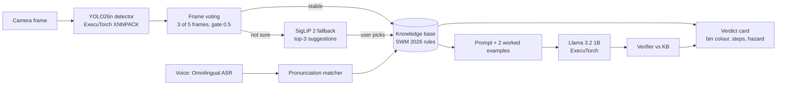

# Technical report: on-device waste segregation assistant

Bharat AI-SoC Challenge, PS2 (Edge AI for waste classification and disposal). Every number below
comes from a result file in `eval/results/`; [eval/REPORT.md](../eval/REPORT.md) regenerates the
tables with `uv run python eval/report.py`. Sections marked **[phone]** or **[detector]** are
filled after the phone session and the detector training run.

## 1. Problem and goal

India's Solid Waste Management Rules, 2026 require households to separate waste into four streams:
**wet** (green bin), **dry** (blue), **sanitary** (red) and **special care** (black). People get it
wrong most on mixed, dirty and hazardous items: a greasy pizza box, a chips packet, a broken CFL
bulb, a used diaper.

Goal: point a phone at an item and get, within a fraction of a second, the right bin, how to prepare
the item, and why — fully offline, in English and Hindi, with Llama running on the phone's Arm CPU
through ExecuTorch.

## 2. Design principle: vision perceives, the knowledge base decides, Llama explains

- **The bin never comes from a neural network's guess.** A curated knowledge base (KB: 53 items,
  condition rules for dirty and broken items, a city profile with bin colours) decides stream, bin,
  steps, hazards and drop-off points. Sources: SWM Rules 2026 and the SBM-Urban source-segregation
  guideline, E-Waste Rules, US EPA guidance for mercury items.
- **Vision only names the item** (detector, frame voting, a "not sure" state) and, for the ten items
  whose advice depends on it, asks whether the item is dirty or broken.
- **Llama 3.2 1B only explains**: a one-or-two-sentence `why` and a `tip`. A verifier checks every
  answer against the KB and drops wrong text (wrong or negated bin or stream, wrong recyclable or
  compostable claim, a KB step turned into "don't", unsafe advice such as drains or burning).
  Off-topic questions are declined before Llama runs.
- **The verdict never waits for Llama**: the card with bin colour and steps appears first, and the
  explanation streams in after it.

## 3. System

Five separate on-device pipelines, all on the Arm CPU, none using the network (the app has no
INTERNET permission). Runtimes, models and memory policy: [PIPELINES.md](PIPELINES.md).

| Stage | Model / method | Size | Runs |
|---|---|---|---|
| Detection | YOLO26n (Ultralytics) fine-tuned on TACO, exported to ExecuTorch XNNPACK; decoding + NMS in app code (the exporter drops the NMS-free head) | ~9 MB | every frame |
| Stability | Confidence gate 0.5; an item is stable after winning 3 of the last 5 frames | – | every frame |
| Unknown items | SigLIP 2 base image encoder, int8 `.pte`, cosine against KB item text embeddings; top 3 offered, never auto-decided | 94 MB | when not sure |
| Dirty / broken | Same SigLIP 2 embedding vs item-specific prompts ("dirty milk pouch" vs "clean milk pouch"); in the unsure band the app asks the user | 0 MB extra | stable item with condition rules |
| Decision | KB (`kb.sqlite`) + city profile | <1 MB | every verdict |
| Explanation | Llama 3.2 1B Instruct SpinQuant INT4 `.pte` + verifier | 1.1 GB | after the card |
| Voice | Omnilingual ASR 300M CTC int8 (sherpa-onnx) → pronunciation-key matcher; Android text-to-speech | 366 MB | push-to-talk |
| Impact | Scan log, items by stream, kg kept out of landfill (estimate), streak; education cards and quiz from KB facts | – | on demand |

**Parity by construction.** Every decision function exists in Python (the laptop reference) and in
plain Kotlin (`android/core`, used by the app). Both pass the same golden fixtures and shared case
files in CI (KB lookup, prompt text byte for byte, verifier, detector decoding, voting, fallback
ranking, dirty/broken check, voice matching, impact, latency summaries, correction log).

## 4. Data and models

- **Knowledge base**: 53 household items in 4 streams, English + Hindi text (Hindi not yet reviewed
  by a native speaker), condition rules for 10 items, one default city profile.
- **Detector data**: TACO (1,500 images). 14 of our KB items have enough TACO instances to train;
  the rest reach the user through the fallback, voice or search. TACO's image licences are mixed
  (466 ODbL, 319 "CC" without a variant, 715 with none); training used all images, the release
  documents this ([THIRD_PARTY.md](../THIRD_PARTY.md), [data/taco_licences.md](../data/taco_licences.md)).
- **Detector training** [detector]: YOLO26n from COCO weights, 640 px, on the laptop CPU (50 epochs,
  early stop after 15 without gain); same notebook runs on a GPU (`models/vision/train.ipynb`).
- **Llama**: the prebuilt `executorch-community` Llama 3.2 1B Instruct SpinQuant INT4 `.pte`. A LoRA
  fine-tune on 470 KB-written examples is fully tooled and dry-run verified but was not run (it
  needs gated weights and a GPU session); prompt design closed most of the gap instead (§5.2).

## 5. Results

### 5.1 Sorting accuracy [detector]

Box mAP50 and mAP50-95 on the TACO test split, per-class precision/recall, item and **stream**
accuracy (the 92% target is on stream: putting an item in the right bin). For reference, the TACO
authors' Mask R-CNN (ResNet-50 FPN, 1024 px) reached 17.6–19.4 mask AP (IoU 0.5:0.95) on their
10-class split; class sets and metrics differ, so this is context, not a head-to-head comparison.

### 5.2 Llama answer quality (laptop, same `.pte` as the phone)

| Setup (SpinQuant 1B, 88 held-out questions, en + hi) | Useful | Valid JSON | Tokens |
|---|---|---|---|
| Restate all 7 facts as JSON (first design) | 10% (format only) | – | – |
| `why` + `tip` only, answer start prefilled (baseline) | 69.3% | 96.6% | 76 |
| + 2 worked examples matched to the question kind | 92.0% | 100% | 61 |
| + stricter rules | 95.5% | 100% | 63 |
| + sampled retry only when the checks fail (**shipped**) | **96.6%** | 100% | 66 |

Useful = valid, passes every verifier check, has a `why` in the requested language. 18 variants
were measured (prompt wording, fact format, examples, KB-written first sentence, temperature,
retries, SpinQuant vs QLoRA): [eval/results/llm_experiments/README.md](../eval/results/llm_experiments/README.md).
A hand check of 16 random answers found them all consistent with the KB; two Hindi answers have
awkward grammar. Off-topic questions: the guard declines all of them (126/126 across validation
and training cases) and wrongly stops none of the 504 on-topic ones. Its fixed test questions are
simple ("What is the capital of France?"), so this shows the guard is not over-eager, not that it
catches every off-topic phrasing.

Whatever still fails is never shown: the card keeps the KB's own text. So the user-facing error rate
for bin and steps is zero by construction; Llama errors only cost an explanation.

### 5.3 Unknown-item fallback

83.5% top-3 (68.4% top-1) on 133 TACO object crops with the int8 encoder that ships, within one
point of fp32 — zero-shot, with no training on our classes.

### 5.4 Dirty / broken check

Zero-shot "broken" on TACO glass crops (136 broken, 110 intact): AUC 0.68. With the shipped band it
answers on its own for 16% of crops at 90% accuracy and asks the user for the rest. "Dirty" has no
labelled data yet, so the app always asks. Honest conclusion: zero-shot condition detection is weak;
asking the user is the safe default.

### 5.5 Voice (Hindi)

Omnilingual ASR + pronunciation matching, synthetic speech: 92.5% of item names and 87.5% of names
inside full sentences matched first time (97.5% in the top 3), no false confident matches. Native
speakers and real kitchens are still to be measured.

### 5.6 Speed, memory, battery, offline proof [phone]

Per-stage p50/p95 (detector, frame to card, Llama first token, tokens/s, after 5 minutes), peak
memory, battery drain over 15 minutes, airplane-mode screen recording. Collected with
`scripts/phone_collect.sh` and the app's timing export ([PHONE_SESSION.md](PHONE_SESSION.md)).
Reference (ExecuTorch README, OnePlus 12): 1B SpinQuant 50.2 tokens/s, 0.3 s to first token.

## 6. Comparison with the state of the art

| | Smart-bin papers (YOLO on Pi 5 / Hailo) | DWaste (2025) | ReLeaf (2026) | Consumer apps | **This project** |
|---|---|---|---|---|---|
| Runs offline on the device | yes | yes | classifier yes; LLM not stated | no (cloud) | **yes, incl. the LLM** |
| Classes / items | 4–6 materials | generic categories | 6 | many | **53 KB items, 14 detected** |
| India SWM 2026 four streams | no | no | no | no | **yes** |
| Advice / explanation | no | no | LLM, not grounded in local rules | chat, cloud | **Llama on the phone, verified against the KB** |
| Dirty / broken / composite items | no | no | no | partly | **condition rules; asks when unsure** |
| Says "not sure" | no | no | no | no | **frame voting + top-3 suggestions** |
| Indian languages, voice | no | no | no | no | **Hindi text + offline voice** |

What the project adds is not a bigger detector but **trustworthy decisions**: an auditable KB owns
every fact, Llama is constrained to explanations and checked, uncertainty is surfaced, and all of it
runs on a phone without a network.

## 7. Lessons

- Constrain the LLM to what only it can add; let deterministic code own the facts.
- Measure content, not format: a format-only "useful rate" of 97.5% hid answers that were wrong a
  third of the time. Once measured properly, two worked examples did more than any rule.
- Run one heavy CPU job at a time: two ExecuTorch runners in parallel were 5–6x slower each.
- Licences decide architecture: AGPL detector → AGPL repo; research-only MobileCLIP → SigLIP 2;
  non-commercial Piper voices → Android's own text-to-speech.

## 8. Limitations and next steps

Detector trained on European litter photos (TACO), not on Indian household waste; India photo set,
retraining and a trained dirty/broken head are next. Hindi KB text unreviewed; Tamil, Telugu, Bengali
and Marathi not yet written. Voice measured on synthetic speech. One city profile. LoRA fine-tune
tooled but not run.

## Reproduce

[README](../README.md) (setup), [PHONE_SESSION.md](PHONE_SESSION.md) (install and measure),
`uv run pytest` and `cd android && ./gradlew :core:test :app:assembleDebug` (tests and APK).
Licences: [THIRD_PARTY.md](../THIRD_PARTY.md). Built with Llama.
